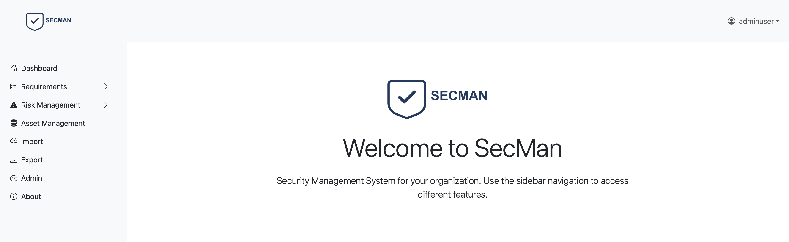

# SecMan

Security requirement, vulnerability and risk-assessment platform.

[](https://www.gnu.org/licenses/agpl-3.0)
[]()



## What it does

- Security requirement lifecycle (versioned releases: PREPARATION → ALIGNMENT → ACTIVE → ARCHIVED), Excel/Word/CSV export, automated translation (OpenRouter, 10 languages).
- Vulnerability management: CrowdStrike Falcon import and remediation guidance, GitHub App Dependabot alert tracking with 30-day non-decrease owner alerts, exception requests, statistics, heatmap, and outdated-asset reporting. CrowdStrike findings use first detection on the affected system as their SLA start. [CrowdStrike import guide](docs/CROWDSTRIKE_IMPORT.md)
- Asset inventory: Nmap/Masscan import, AD/cloud metadata, criticality, and workgroup-scoped access. Current inventory requires a verified observation within the last 24 hours (UTC). Falcon-managed assets use the last sensor contact. [Current asset visibility](docs/CURRENT_ASSETS.md)
- Risk register, demand classification, compliance-framework mapping (SOC2, ISO 27001, NIST), optional AI-assisted pre-fill of compliance answers (OpenRouter LLM, confidence scoring + citations, human review required).
- AWS account onboarding: imports requesting notifications use a saved welcome-email (default) or risk-assessment policy. The welcome subject and body are editable in the web UI; advanced guided questionnaires remain supported.
- Risk assessments support SaaS and COTS solution names, searchable existing assessors/respondents, and email-only respondents who need no SecMan account.
- AuthN: local (BCrypt) + OAuth2/OIDC + Passkey/WebAuthn + optional MFA.
- AuthZ: 10-role RBAC (including the additive BETA eligibility role) with asset access through workgroup, AWS account, AD domain, and sharing grants.
- AI integration: MCP server (Streamable HTTP) for Claude Desktop/Code, Paperclip, and other MCP clients, with mandatory user delegation.
- Email: SMTP/SES with retry + audit, Thymeleaf HTML templates, escalation tiers.
- Inactive-user cleanup: an opt-in nightly job warns users before deletion, records each run, and applies a safety brake; dry-run is the default.

## Stack

Kotlin 2.4.21 / Java 25 · Micronaut 5.2.5 · Hibernate JPA · Astro 7.4.13 + React 19 · Bootstrap 5.3 · MariaDB 11.4 · Gradle 9.9.1 (Kotlin DSL) · Picocli 4.7.7 · AWS SDK v2 · Go 1.24 (mobile relay).

## Quick Start (development)

Install a Java 25 JDK, Node.js 22.23.4+ with npm, MariaDB 11.4+ with the `mysql` client command, Git, OpenSSL, and Proton Pass CLI (`pass-cli`). Start MariaDB and authenticate `pass-cli`. See the [installation guide](INSTALL.md) for platform-specific setup.

The dev scripts read fields from the `Test` vault's `SECMAN` item. For a local stack, set `SECMAN_BACKEND_BASE_URL` to `http://localhost:8080` and `DB_CONNECT` to `jdbc:mariadb://localhost:3306/secman`. An exported `DB_CONNECT` in the backend terminal takes precedence. Configure the remaining fields referenced by the start scripts using the [Proton Pass guide](docs/PASS_CLI.md).

```bash
git clone https://github.com/schmalle/secman.git && cd secman
(cd scripts/install/db && ./installdb.sh)  # Creates the local secman database and user.
(cd src/frontend && npm ci)
```

From the repository root, start the backend in one terminal. The cookie setting below is for local HTTP development.

```bash
SECMAN_AUTH_COOKIE_SECURE=false ./scripts/startbackenddev.sh
```

From the repository root in a second terminal, start the frontend.

```bash
./scripts/startfrontenddev.sh
```

Open <http://localhost:4321>. On startup with an empty users table, the backend creates `admin` and prints a generated 20-character password to stdout in the `DEFAULT ADMIN USER CREATED` banner. Change the password after signing in.

> **Production deployments** require a unique database password, `JWT_SECRET`, `SECMAN_ENCRYPTION_PASSWORD`, and `SECMAN_ENCRYPTION_SALT`. Follow the [deployment guide](docs/DEPLOYMENT.md).

## Layout

```
src/
  backendng/   Kotlin/Micronaut: domain → repository → service → controller, mcp/, dto/, filter/
  frontend/   Astro pages + React islands, services/ (Axios)
  cli/        Picocli commands + service/
  shared/     Kotlin code shared by the backend and CLI
  adread/     Python AD workgroup import + AWS asset synchronization
  relay/      Go: zero-dependency DMZ relay for the mobile app
  clinotify/  stdlib-only Python monitoring helpers
docs/         see below
scripts/     ALL scripts live here (canonical — never invoke gradle/npm/etc. directly for dev start)
specs/        historical implementation plans (frozen)
```

## Common commands

```bash
# Full Gradle build with a disposable database
./scripts/test/run-isolated-e2e.sh --database-only -- ./gradlew build  # full build incl. tests

# CLI (build once, then use the wrapper)
./gradlew :cli:shadowJar
./scripts/secman help
./scripts/secman query servers --device-type SERVER_FAMILY --last-seen-days 1 --dry-run
./scripts/secman send-notifications --dry-run --verbose
./scripts/secman manage-user-mappings list --send-email --dry-run
./scripts/secman export-requirements --format xlsx

# Python importer: preview AWS asset assignments from canonical workgroup owners
./scripts/sync-workgroup-assets.sh --dry-run
# AWS Secrets Manager variant (set SECMAN_AWS_SECRET_ID and the AWS region)
./scripts/sync-workgroup-assets-aws.sh --dry-run

# Tests
./scripts/runbackendtests.sh --tests "*ServiceTest*"      # focused service tests
./scripts/runbackendtests.sh --tests "*IntegrationTest*"  # integration (disposable MariaDB, see docs/TESTING.md)
./gradlew :cli:test
(cd src/frontend && npm test)
```

See the [CLI reference](docs/CLI.md) for command options, the [workgroup asset sync guide](docs/WORKGROUP_ASSET_SYNC.md) for importer setup, and the [testing guide](docs/TESTING.md) for full-stack and feature tests with the isolated runner.

## API and configuration

Browser sessions use the HttpOnly `secman_auth` cookie. See the
[API map](CLAUDE.md#api-endpoints-concise) for endpoint families and the
[access guide](docs/USER_ACCESS_OVERVIEW.md) for object-level grants.

For MCP clients, follow [client setup](docs/MCP_CLIENT_SETUP.md). The
[MCP reference](docs/MCP.md) lists tools and permissions. Tool discovery and
calls require both the API key and a delegated user email.
Users can create a personal key from **Profile → Personal MCP keys** for read-only access to their visible inventory and AWS accounts. [Personal MCP keys](docs/MCP.md#personal-inventory-keys)

Use the [environment reference](docs/ENVIRONMENT.md) for configuration
and the [deployment guide](docs/DEPLOYMENT.md) for production setup.

## Documentation

- [Install and run SecMan](INSTALL.md)
- [Browse operator, feature, and developer guides](docs/README.md)
- [Review release history](docs/CHANGELOG.md)

## Workflow

Use `dev` or a `task/<name>` branch created from `dev`, and use `type(scope): description` for commit messages. Authentication, encryption, RBAC, and export changes require a security review before merge. [Repository guidelines](AGENTS.md)

## Roadmap (open)

Vulnerability correlation/trending · automated remediation workflows · Tenable/Qualys integrations · advanced reporting dashboards · SAML/LDAP · ML risk scoring.

## License & contact

[AGPL-3.0](https://www.gnu.org/licenses/agpl-3.0). Maintainer: Markus "flake" Schmall — markus@schmall.io · [@flakedev@infosec.exchange](https://infosec.exchange/@flakedev). Built with assistance from Anthropic Claude.

> **Alpha software.** Test before production use.
