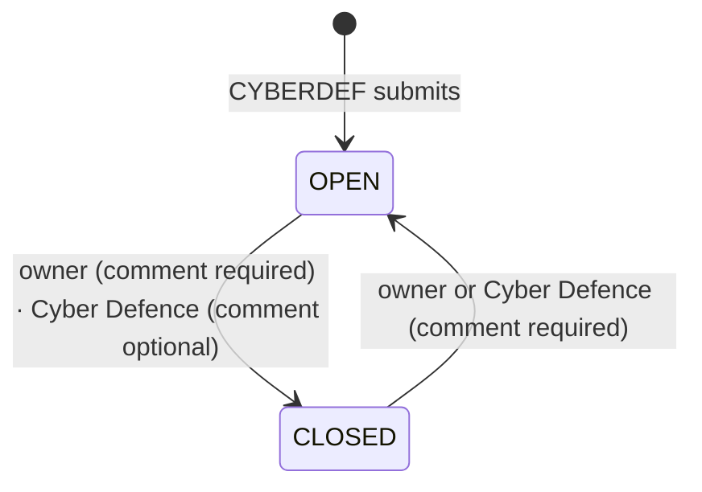

# Cyber Defence account tickets

Cyber Defence records AWS account findings in SecMan and tracks remediation with the people
responsible for those accounts. A ticket starts **OPEN**, with a severity, a due date where
applicable, and the evidence needed to act. SecMan queues email to the resolved recipients.
An account owner records what they did and closes the ticket. Cyber Defence reviews the response
and can reopen the ticket if more work is needed. Both sides can comment throughout.

**Closing is the supported way to retire a finding.** The ticket remains visible under
**Closed** and **All** with its activity history. There is no ticket deletion, purge or `delete`
command in the UI, REST API, MCP tools or shell scripts. If a finding was raised in error,
Cyber Defence can close it with a reason so the recipient understands why it was withdrawn.

For a handover, start with the [workflow](#workflow) and the [shell walkthrough](#shell-walkthrough).
For developers, use the [REST API](#rest-api-apisecurity-tickets), [MCP tool list](#mcp-tools)
and [verification commands](#tests-and-samples).

## Roles and access

| Action | CYBERDEF | ADMIN | SECCHAMPION | Account member | Others |
|---|---|---|---|---|---|
| Submit tickets (incl. dry run, recipient override) | ✔ | ✔ | ✖ | ✖ | ✖ |
| Read **all** tickets | ✔ | ✔ | ✔ | ✖ | ✖ |
| Poll the MCP update feed | ✔ | ✔ | ✖ | ✖ | ✖ |
| Read tickets of own accounts | — | — | — | ✔ | ✖ |
| Close / reopen | ✔ (as defence) | ✔ | ✔ (as owner) | ✔ (as owner) | ✖ |
| Comment | ✔ | ✔ | ✔ | ✔ | ✖ |
| Mail delivery status / resend | ✔ | ✔ | ✖ | ✖ | ✖ |

- `CYBERDEF` grants **no** asset, vulnerability or account visibility of its own. Its MCP
  role mapping is `TICKETS_SUBMIT` only.
- An *account member* is anyone with access to the ticket's AWS account under the same rule
  the asset inventory uses (`AssetFilterService.getAccessibleAwsAccountIds`): personal
  mapping, membership of an enabled workgroup with an AWS-account grant, or received
  AWS-account sharing. It is evaluated **live**.
- A ticket outside the caller's scope is **404** / `NOT_FOUND`, never 403.
- The MCP status tools act for one side only: `set_cyberdef_ticket_status` acts as defence,
  `update_my_security_ticket_status` as owner.

## Workflow



- Owners close with a note on what they did. Cyber Defence may close without one, for
  example for a withdrawn finding or a fix verified elsewhere.
- Either side reopens, always with a reason.
- ADMIN holds both sides. REST transitions prefer the Cyber Defence side for callers who hold
  both. The owner MCP tool records a transition as `OWNER`, including when an admin uses it.
- Pass `expectedVersion` (the `ticket.version` you last read) when closing or reopening. The
  API accepts transitions without it. A supplied version that differs from the current version
  returns `VERSION_CONFLICT`. Read the ticket again before deciding whether to retry.
- Standalone comments require the ticket ID and comment text. They appear in the activity log and
  event feed on both open and closed tickets. They do not queue email.
- An overdue ticket is **OPEN** with a due date in the past. It stays open until someone closes it.
- Responses carry `allowedTransitions` and `commentRequiredFor` for the calling user; the
  server re-checks every move inside the write transaction (`CyberdefTicketWorkflow`).

## Submitting

A submission is `{ticket, delivery}`, or `{tickets: [...], delivery}` for a batch. `ticket`
is the finding. `delivery` holds the sending options (`dryRun`, `recipients`,
`allowUnrouted`), set once per call and applied to every ticket of a batch.

Supply `awsAccountId` as a 12-digit string, plus `title`, `severity` (`CRITICAL`, `HIGH`,
`MEDIUM`, `LOW` or `INFO`) and `description`. Optional fields are `externalReference`,
`recommendedAction`, `cves`, `resources`, `references`, `sourceSystem` and `dueAt` (an ISO-8601
instant). Keep a stable `externalReference` for each upstream finding and reuse the same submitter
when retrying it.

Single and batch calls return the same per-ticket result:
- `index`;
- `outcome`: `CREATED`, `DUPLICATE`, `WOULD_CREATE` or `REJECTED`;
- `ticketId`, `ticketKey`, `status`, `dueAt`;
- `recipients`, `recipientsOverridden`;
- `dryRun`, `recipientCount` and `errorCode`;
- `errors`: `[{field, code, message}]`, where `field` is a path such as `title`,
  `resources[2].region` or `delivery.recipients[0]`. A form can show each message next to
  its input.

Field codes: `REQUIRED`, `INVALID`, `TOO_LONG`, `TOO_MANY`, `NOT_FUTURE`,
`ACCOUNT_MISMATCH`, `UNKNOWN_FIELD`, `WRONG_TYPE`, `NOT_ALLOWED`.

- **Idempotency**: `externalReference` (`[A-Za-z0-9._:/#-]{1,128}`) is unique per
  submitter. Resending it returns the existing ticket as `DUPLICATE` without new mail.
- **Batch**: `create_cyberdef_tickets` takes 1–100 items and commits each separately. It
  returns `CREATED | DUPLICATE | REJECTED | WOULD_CREATE` per item.
- **Unrouted accounts**: when nobody is allocated to the account the item is rejected as
  `UNROUTABLE_ACCOUNT`. `allowUnrouted: true` creates it with zero recipients; naming
  `recipients` also avoids the rejection.
- **Due date**: defaults from the severity SLA. An explicit `dueAt` must be in the future
  and within that window. With no configured SLA (the INFO default), a ticket has no default
  due date and accepts an explicit date up to 365 days out.
- **Limits**: title 200, description 20 000, recommended action 10 000, comment 4 000
  characters; 100 CVEs, 500 resources, 20 references, 20 recipients per ticket;
  `max-tickets-per-hour` stored tickets per submitter. Unknown fields are rejected.
- **ARNs**: a resource identifier that is an ARN needs no `type` or `region`; both are taken
  from the ARN (e.g. `arn:aws:ec2:eu-central-1:…:instance/i-1` → `EC2_INSTANCE`,
  `eu-central-1`). The ARN's account must be the ticket's `awsAccountId`
  (`ACCOUNT_MISMATCH` otherwise), so a ticket cannot point at another tenant's resources.
- **Ticket key**: `CD-<year>-<id>` uses the UTC creation year and a numeric ID padded to at least
  six digits, for example `CD-2026-000042`. Use `ticketId` for REST detail and script mutations.
  Use `ticketKey` for display and MCP lookups, or the original submitter's `externalReference`
  in the Cyber Defence lookup.
- **Batch cost**: duplicates, the hourly count and recipient routing are read once per call
  (routing once per distinct account), not once per ticket. A `delivery.recipients` override
  is checked once per call with two queries for the whole list; only the account name is
  looked up per account. The hourly count uses `idx_cyberdef_ticket_submitter_created` (V312).
- **Request cost**: a caller's accessible accounts are computed once per request and reused
  for the visibility check, the workflow sides and the response. Never cached across requests,
  so revoked access still takes effect on the next call.
- **References** must be absolute `https` URLs without credentials. They are display-only
  and never fetched.

### Dry run

`delivery.dryRun: true` on a create (single or batch) runs the
same validation, idempotency check, rate limit, due-date calculation and recipient
resolution as a real submission. Then it stops: nothing is stored, no event is written, no
mail is queued. Expect `WOULD_CREATE` with `recipients` and `dueAt`, `DUPLICATE` for an
existing reference, or `REJECTED` with the reason. The rate limit counts only stored
tickets, so dry runs leave that budget available.

`dryRun: true` on a status change (`set_cyberdef_ticket_status`,
`update_my_security_ticket_status`, or REST `POST …/transitions`) checks the version and the
workflow and returns a preview `{fromStatus, toStatus, actingAs, wouldNotify, currentVersion}`.
Nothing changes.

### Target addresses (`recipients`)

`delivery.recipients: ["a@…", …]` (max 20) mails these addresses **instead of** the account's owners.
Use it to route a ticket to a specific team or to test with your own mailbox. Each address
must be either

- known to SecMan, meaning the email of a user or of a user mapping, or
- on a domain in `secman.cyberdef.recipient-override.allowed-domains`.

Otherwise the item is rejected as `RECIPIENT_NOT_ALLOWED`, so SecMan's mail server cannot be
used to write to arbitrary inboxes.

- Override recipients are recorded with source `OVERRIDE`. Later Cyber Defence status
  changes are mailed to them too.
- Being mailed grants **no access**: the ticket stays visible only to account members and
  the global roles.
- Every use is audit-logged (`overridden=true`).

## Notifications

Without an override, SecMan resolves recipients at creation from two sources.

1. every personal mapping of the account, including future users without a login yet;
2. direct members of **enabled** workgroups holding an AWS-account grant for it.

Addresses are lower-cased, validated and deduplicated, then capped at `max-recipients`.
Received AWS-account sharing grants visibility but no mail. The recipient list is an audit
record and grants no access.

| Event | Who is mailed | Template |
|---|---|---|
| Ticket created | the recipients | `cyberdef-ticket-created` |
| Several tickets created in one call | each recipient once, listing all of their tickets, most severe first | `cyberdef-ticket-digest` |
| Cyber Defence closes or reopens | the recipients | `cyberdef-ticket-update` |
| An owner closes or reopens | the submitter, only with `notify-submitter: true` | `cyberdef-ticket-update` |

Mail goes through an outbox (`cyberdef_ticket_notification`) written in the same
transaction as the change. It is sent afterwards on the IO pool, claimed per row with one
conditional `UPDATE`, and retried by a recovery job if a crash left it `PENDING`. Creation rows of
one call share a `batch_key`; the dispatcher sends one digest per recipient for them. A
possibly-accepted transport failure is `UNCERTAIN` and never retried automatically. `FAILED`
rows can be resent. Check `GET /api/security-tickets/{id}/notifications` for delivery state,
attempt count and any error code. `CREATED` confirms that SecMan stored the ticket. Inspect the
outbox separately for mail status. By default mail carries the key, account, severity, title,
due date and a link (`include-summary: false`).

## REST API (`/api/security-tickets`)

| Method & path | Roles | Purpose |
|---|---|---|
| `GET /` | authenticated, scoped | Paged list. Query: `status` (`OPEN`/`CLOSED`), `severity`, `accountId`, `createdByMe`, `overdue`, `updatedSince`, `q`, `page`, `size` (≤ 200), `sort` (`updatedAt`/`createdAt`/`dueAt`), `direction` |
| `GET /summary` | authenticated, scoped | `total`, `open`, `closed`, `overdue` |
| `GET /{id}` | scoped | Numeric ID. Detail with resources, CVEs, the first 500 activity events, `allowedTransitions`, `commentRequiredFor` |
| `POST /{id}/transitions` | scoped + workflow | `{toStatus, comment, expectedVersion, dryRun}` |
| `POST /{id}/comments` | scoped | `{comment}` |
| `POST /` | ADMIN, CYBERDEF | Submit `{ticket, delivery}`. 201 created, 200 duplicate or dry run, 4xx with the same result body when rejected |
| `POST /batch` | ADMIN, CYBERDEF | Submit `{tickets, delivery}` (1–100); 200 with one result per ticket |
| `GET /meta` | ADMIN, CYBERDEF | Severities with SLA days, field limits, suggested resource types, override domains |
| `GET /accounts?q=&limit=` | ADMIN, CYBERDEF | Account picker: `{awsAccountId, accountName, recipientCount, routable}`. No email addresses |
| `GET /{id}/notifications` | ADMIN, CYBERDEF | Mail delivery per recipient |
| `POST /{id}/notifications/resend` | ADMIN, CYBERDEF | Retry `FAILED` rows |

Errors are `{"error": CODE, "message": text, "errors": [{field, code, message}]}`:
- 400 `VALIDATION_ERROR` / `COMMENT_REQUIRED`
- 403 `FORBIDDEN`
- 404 `NOT_FOUND`
- 409 `VERSION_CONFLICT` / `INVALID_TRANSITION`
- 422 `UNROUTABLE_ACCOUNT` / `RECIPIENT_NOT_ALLOWED`
- 429 `RATE_LIMITED`

## MCP tools

All tools require User Delegation. The Cyber Defence tools also require the **delegated
user** to hold `CYBERDEF` or `ADMIN`; an admin API key alone is not enough.

| Tool | Permission | Notes |
|---|---|---|
| `create_cyberdef_ticket` | `TICKETS_SUBMIT` | `{ticket, delivery}`; same result shape as one batch item |
| `create_cyberdef_tickets` | `TICKETS_SUBMIT` | `{tickets: [1–100], delivery}`; one digest mail per recipient |
| `list_cyberdef_tickets` | `TICKETS_SUBMIT` | all accounts |
| `get_cyberdef_ticket` | `TICKETS_SUBMIT` | by `id`, `ticketKey` or your `externalReference` |
| `get_cyberdef_ticket_updates` | `TICKETS_SUBMIT` | cursor feed |
| `set_cyberdef_ticket_status` | `TICKETS_SUBMIT` | `OPEN`/`CLOSED` as defence; `dryRun` |
| `add_cyberdef_ticket_comment` | `TICKETS_SUBMIT` or `TICKETS_RESPOND` | either side, scoped |
| `list_my_security_tickets` | `TICKETS_RESPOND` | normal ticket read scope, including global roles |
| `get_my_security_ticket` | `TICKETS_RESPOND` | by `id` or `ticketKey`, using the same read scope |
| `update_my_security_ticket_status` | `TICKETS_RESPOND` | `OPEN`/`CLOSED` as owner; `dryRun` |

`TICKETS_RESPOND` is part of every delegated user's effective permissions, like
`PERSONAL_INVENTORY_READ`, because the tools scope everything to the caller's accounts. The
API key still caps it.

Both MCP list tools take `status` and `severity` arrays, `awsAccountId`, `overdue`,
`updatedSince` (ISO-8601), `q` (title or ticket key), zero-based `page`, and `size` (max 200).
`list_cyberdef_tickets` also accepts `createdByMe`. The shell list commands expose status,
account, overdue and pagination. REST uses the query parameter `accountId` and offers sorting.

A JSON-RPC error message starts with the stable code, for example
`VERSION_CONFLICT: The ticket changed …`. The codes are `VALIDATION_ERROR`,
`COMMENT_REQUIRED`, `INVALID_TRANSITION`, `FORBIDDEN`, `NOT_FOUND`, `VERSION_CONFLICT`,
`UNROUTABLE_ACCOUNT`, `RECIPIENT_NOT_ALLOWED`, `RATE_LIMITED` and `INTERNAL_ERROR`. In a batch
result, per-item rejections carry the code in `errorCode` and the field problems in `errors`;
argument errors list `field: problem` pairs inside the message.

### Example: dry run with target addresses

```json
{
  "name": "create_cyberdef_ticket",
  "arguments": {
    "ticket": {
      "externalReference": "SOC-2026-4711",
      "awsAccountId": "123456789012",
      "title": "Publicly exposed RDS snapshot",
      "severity": "HIGH",
      "description": "Snapshot `db-prod-2026-11-20` is shared with `all`.",
      "resources": [{"identifier": "arn:aws:rds:eu-central-1:123456789012:snapshot:db-prod-2026-11-20"}]
    },
    "delivery": {"recipients": ["analyst@soc.example"], "dryRun": true}
  }
}
```

Returns `{"index":0,"outcome":"WOULD_CREATE","status":"OPEN","recipients":["analyst@soc.example"],"recipientsOverridden":true,"dueAt":"…","dryRun":true}`.
Drop `dryRun` to create it: the outcome becomes `CREATED` with `ticketId` and `ticketKey`.

## UI

- **`/cyberdef/new` (CYBERDEF, ADMIN): single ticket.** The sections are Target, Finding,
  Evidence and Delivery, with a preview panel beside them.
  - Target uses an account type-ahead (`/accounts`) showing how many people a ticket reaches,
    or "no owner".
  - Severity buttons show the SLA from `/meta`. The description is Markdown.
  - Resources accept pasted ARNs or `TYPE=id@region`, with a warning for ARNs of another account.
  - Delivery is either the account owners or specific people.
  - After each edit, a debounced dry run (500 ms) fills the preview: recipients and due date,
    or the field errors, shown next to each input. Validation rules are not repeated in the UI.
  - The form generates one idempotency key (`ui-<uuid>`) when it opens, so a double submit
    returns `DUPLICATE`.
  - After creating, the browser goes to the ticket's detail page.
- **`/cyberdef/new`: bulk import.** Paste or upload JSON, or CSV with a header row using the
  ticket field names (lists separated by `;`). Check runs a batch dry run and shows a
  per-row outcome table; Create submits only the rows that would be created.
- **`/security-tickets`.** Open/Closed/All tabs, search by title or key, count tiles.
- **`/security-tickets/{id}`.** Description, resources, CVEs, links and the activity log.
  Close, reopen and comment buttons follow the server's `allowedTransitions` and
  `commentRequiredFor`; a conflicting change asks the user to reload.

Pure UI logic lives in `services/securityTicketLogic.ts` (tested by
`securityTicketLogic.test.ts`). The API client is `services/securityTicketService.ts`.

### Handling answers: the update feed

`get_cyberdef_ticket_updates {sinceEventId, limit}` returns every event after the cursor,
oldest first: `CREATED`, `STATUS_CHANGED` (`toStatus` `OPEN`/`CLOSED`) and `COMMENT`. Each
event carries `ticketId`, `ticketKey`, `actorKind` (`OWNER`/`DEFENDER`) and `comment`. The
response also has `nextCursor` and `hasMore`. Store the last successfully handled event ID and
pass it back as `sinceEventId`. Once the entire page succeeds, that ID equals `nextCursor`.
The server holds recent events back for five seconds to allow transactions to settle.

A typical review loop starts with the events read by `ticket-updates.sh`. The sample handler
logs events and prints suggested follow-up commands for an operator.

1. `STATUS_CHANGED` to `CLOSED` by an `OWNER`: verify the fix. Keep it closed, or
   `set_cyberdef_ticket_status {toStatus: OPEN, comment}`.
2. `COMMENT` by an `OWNER`: answer with `add_cyberdef_ticket_comment`.
3. For a status change, pass `expectedVersion` from `get_cyberdef_ticket`. Reload on `VERSION_CONFLICT`.

## Shell walkthrough

Run the following commands from the repository root. The scripts use Bash, `curl` and `jq`.
For live calls they read `SECMAN_BACKEND_URL` and `SECMAN_MCP_KEY` from the environment and
fall back to `pass-cli run` with the repository's `secmanpp.env` if either is missing. Set
the delegated user with `--as EMAIL`. The defaults are `SECMAN_CYBERDEF_EMAIL`, then
`SECMAN_ADMIN_EMAIL`. Pass `--as` explicitly when demonstrating an ordinary owner's scope.
The MCP key needs User Delegation and the appropriate ticket permission.

| Script | Use it to |
|---|---|
| [`send-ticket.sh`](../scripts/cyberdef/send-ticket.sh) | Send one finding from flags, a JSON file or both. Supports `--allow-unrouted`. |
| [`send-tickets.sh`](../scripts/cyberdef/send-tickets.sh) | Send a JSON array or `{ "tickets": [...] }` in chunks of at most 100. |
| [`ticket-status.sh`](../scripts/cyberdef/ticket-status.sh) | List, inspect, close, reopen or comment as Cyber Defence. `get` also accepts the submitter's `--ref`. |
| [`my-tickets.sh`](../scripts/cyberdef/my-tickets.sh) | List, inspect and comment within your read scope, and close or reopen as an owner where you have owner authority. |
| [`ticket-updates.sh`](../scripts/cyberdef/ticket-updates.sh) | Read the event feed once or continuously, with an optional executable handler. |

### Send one finding or a batch

These commands print the JSON-RPC requests offline, with the key masked. The batch preview
prints the first chunk. `--print-request` works without server access or credentials.

```bash
./scripts/cyberdef/send-ticket.sh --file scripts/cyberdef/examples/ticket.json --dry-run --print-request
./scripts/cyberdef/send-tickets.sh --file scripts/cyberdef/examples/tickets.json --dry-run --print-request
```

For a server dry run, copy the applicable fixture and replace the sample account IDs and
finding data. Keep any ARN account IDs consistent with the ticket. Remove `--print-request`
and keep `--dry-run` to check validation, recipients and the due date. To submit, rerun with
the same input and remove `--dry-run`. Both send scripts accept a recipient override with
`--to ADDR[,ADDR]`. The single-ticket script also accepts `--allow-unrouted` to record a finding
with zero recipients when the account has no route.

The single-ticket script prints one result. The batch script prints one JSON line per
ticket with its zero-based index in the source file and writes totals to stderr. A batch
can partially succeed. Correct rejected items and reuse the same `externalReference` and
submitter for any retry. Exit codes are `0` for success, `1` for runtime or MCP errors,
`2` for local usage errors and `3` for reported submission rejections.

### Query, close and reopen

Use the ID or key returned on submission. In the examples, replace `42`, `CD-2026-000042`,
the account ID and the email with values from the target environment. Replace `3` with the
current `ticket.version` from `get` before previewing or applying a transition.

```bash
./scripts/cyberdef/ticket-status.sh list --status OPEN --account 123456789012 --overdue --page 0 --size 25
./scripts/cyberdef/ticket-status.sh get --key CD-2026-000042
./scripts/cyberdef/my-tickets.sh get --id 42 --as owner@example.test
./scripts/cyberdef/my-tickets.sh close --id 42 --expected-version 3 \
  --comment 'Removed public access and verified the change.' --as owner@example.test --dry-run
```

Review `wouldNotify` and remove `--dry-run` to close the ticket. For a withdrawn finding,
Cyber Defence uses `ticket-status.sh close --id 42 --comment 'Withdrawn after review.'`
with the current `--expected-version`. To send a follow-up without changing the status,
use either status script with `comment --id 42 --comment 'Please share the verification result.'`.
If the finding still applies, use `ticket-status.sh reopen --id 42 --comment 'Snapshot is still public.'`
with the current version. Add `--dry-run` to preview either transition.

**Verification on `dev` (`7d4941427`).** The isolated MariaDB run reported Hibernate
`SemanticException` in the ticket list query in two integration tests. The list command
uses that query. Use `get` with a known ID or key to inspect a ticket while the list issue
is open. The integration test for lookup by key passed.

### Read responses continuously

```bash
./scripts/cyberdef/ticket-updates.sh --since 0 --limit 25 --print-request
./scripts/cyberdef/ticket-updates.sh --state ./cyberdef-demo.cursor --follow --interval 120 \
  --on-event ./scripts/cyberdef/examples/on-event.sh
```

The second command makes authenticated read calls and writes local state. The script saves
the cursor after each successfully handled event. A failed handler stops the run with the
cursor before that event. A crash between the handler's work and the cursor write can replay
the event, so deduplicate downstream writes by event ID. Use a separate cursor file per
environment and consumer. See the [shell reference](../scripts/cyberdef/README.md) for all flags.

## Tests and samples

| Checked-in file or directory | Purpose |
|---|---|
| [`examples/ticket.json`](../scripts/cyberdef/examples/ticket.json) | One finding with an AWS ARN, remediation and a reference link. |
| [`examples/tickets.json`](../scripts/cyberdef/examples/tickets.json) | Two findings for separate AWS accounts. Due dates use the configured SLA. The same array can be pasted into the browser's bulk import. |
| [`examples/on-event.sh`](../scripts/cyberdef/examples/on-event.sh) | Reads event JSON from stdin and appends it to `CYBERDEF_EVENT_LOG` or the default state directory's `events.jsonl`. Prints owner actions and suggested follow-ups. |
| [`cyberdef-scripts-test.sh`](../scripts/test/cyberdef-scripts-test.sh) | Loopback MCP stub checks request construction, overrides, dry runs, batching, cursor handling and errors with fixture credentials. |
| [Backend ticket tests](../src/backendng/src/test/kotlin/com/secman/service/cyberdef/) | Unit coverage for arguments, input, ARN parsing, routing, submission, access, state transitions and the mailer. [`CyberdefTicketIntegrationTest.kt`](../src/backendng/src/test/kotlin/com/secman/service/cyberdef/CyberdefTicketIntegrationTest.kt) exercises persistence, mail outbox records, the event cursor and scoped reads. |
| [`McpDelegationTicketPermissionTest.kt`](../src/backendng/src/test/kotlin/com/secman/service/McpDelegationTicketPermissionTest.kt) | Covers role-to-permission mapping and the MCP key's permission cap. |
| [`securityTicketLogic.test.ts`](../src/frontend/src/services/securityTicketLogic.test.ts) | Covers form payloads, parsing, previews, field errors, due dates, and JSON/CSV bulk input. |

Run the shell self-test with `bash`, `curl`, `jq` and `python3` available. It also runs
ShellCheck when installed. Use the [isolated backend wrapper](../scripts/runbackendtests.sh)
for the MariaDB-backed tests.

```bash
./scripts/test/cyberdef-scripts-test.sh
./scripts/runbackendtests.sh --tests 'com.secman.service.cyberdef.*' \
  --tests 'com.secman.service.McpDelegationTicketPermissionTest'
(cd src/frontend && node --experimental-strip-types --import ./test/register.mjs \
  --test src/services/securityTicketLogic.test.ts)
```

For a manual browser walkthrough in a test environment, sign in as Cyber Defence and open
**Security tickets → New ticket**. Preview a finding for a test account, submit it, then sign
in as a user with access to that account and close it with a remediation note. Check that an
unrelated user cannot open the ticket. Return as Cyber Defence, confirm the owner event,
and preview a reopen. Inspect the ticket's notification state separately if checking email.

## Configuration (`secman.cyberdef.*`)

| Key | Env | Default | Meaning |
|---|---|---|---|
| `sla.critical-days` … `sla.info-days` | `CYBERDEF_SLA_*_DAYS` | 2 / 7 / 30 / 90 / 0 | Default due window; 0 = none |
| `mail.include-summary` | `CYBERDEF_MAIL_INCLUDE_SUMMARY` | `false` | Put description/comment into mail |
| `mail.notify-submitter` | `CYBERDEF_MAIL_NOTIFY_SUBMITTER` | `false` | Mail the submitter when owners change the status |
| `max-recipients` | `CYBERDEF_MAX_RECIPIENTS` | 50 | Recipient cap per ticket (resolved owners) |
| `max-tickets-per-hour` | `CYBERDEF_MAX_TICKETS_PER_HOUR` | 600 | Stored submissions per submitter per hour |
| `recipient-override.allowed-domains` | `CYBERDEF_RECIPIENT_OVERRIDE_DOMAINS` | empty | Comma list of domains `recipients` may mail besides known SecMan addresses |

The mail link uses `app.frontend.base-url`.

## Data model

Migrations `V310__cyberdef_tickets.sql`, `V311__cyberdef_ticket_key_and_digest.sql`
(drops the stored key, adds the outbox `batch_key`) and `V312__cyberdef_ticket_submitter_index.sql`
(index for the hourly limit): `cyberdef_ticket` (status `OPEN`/`CLOSED`,
`closed_at`, `@Version`), `cyberdef_ticket_resource`, `cyberdef_ticket_event` (append-only;
id = cursor), `cyberdef_ticket_recipient` (audit; source `MAPPING`/`WORKGROUP`/`OVERRIDE`)
and `cyberdef_ticket_notification` (outbox). Users are referenced by id plus a username
snapshot without a foreign key, so the inactive-user cleanup keeps ticket history intact.

## Security notes

- A01: every read and write resolves through `CyberdefTicketAccess`. List queries take the
  account set computed in Kotlin as a bound parameter. Override recipients get mail, never
  access.
- A03/A09: free text keeps newlines and tabs only; single-line fields lose newlines too. HTML
  mail escapes every value, and submitter text is substituted last. Audit lines carry actor,
  target and outcome, never comment bodies.
- A04: every field, list, page and batch is bounded; submissions are rate-limited; the
  recipient override is restricted to known addresses or allowlisted domains.
- A10: reference URLs are display-only and never fetched.
- Scripts never put the API key on a command line.

## Code map

`domain/CyberdefTicket*.kt` · `repository/CyberdefTicket*Repository.kt` ·
`service/cyberdef/` (`CyberdefTicketWorkflow`, `CyberdefTicketInput`,
`CyberdefRecipientResolver`, `CyberdefTicketAccess`, `CyberdefTicketWriter`,
`CyberdefTicketMailer`, `CyberdefTicketMailRenderer`, `CyberdefTicketSubmissionService`,
`CyberdefTicketService`, `CyberdefTicketQueryService`, `CyberdefAccountDirectory`, `CyberdefTicketMeta`,
`CyberdefTicketArguments`, `AwsArn`) ·
`controller/CyberdefTicketController.kt` · `mcp/tools/*Cyberdef*Tool.kt`,
`*SecurityTicket*Tool.kt` · `email-templates/cyberdef-ticket-*.{html,txt}` ·
`scripts/cyberdef/` · frontend `components/securityTickets/`, `pages/security-tickets*`, `pages/cyberdef/new.astro`.
