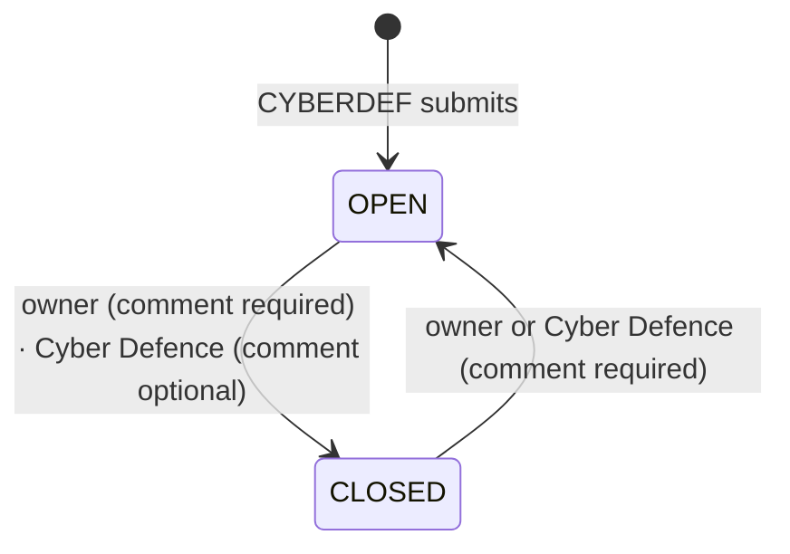

# CYBERDEF Account Tickets

The cyber-defence team (role `CYBERDEF`) reports vulnerability findings about **AWS
accounts** to SecMan through MCP. SecMan turns each finding into a ticket, mails the people
allocated to that account, and tracks it as **OPEN** or **CLOSED**. Owners close the ticket
with a note on what they did. Cyber Defence reads those answers from a cursor feed and can
reopen a ticket. Both sides comment.

Status: **backend, REST, MCP, shell scripts and UI implemented**:
- `/security-tickets`: list, for everyone, scoped to their accounts;
- `/security-tickets/{id}`: detail with close, reopen and comment;
- `/cyberdef/new`: the creation form and bulk import, for CYBERDEF and ADMIN;
- `scripts/cyberdef/`: the shell clients.

## Roles and access

| Action | CYBERDEF | ADMIN | SECCHAMPION | Account member | Others |
|---|---|---|---|---|---|
| Submit tickets (incl. dry run, recipient override) | ✔ | ✔ | ✖ | ✖ | ✖ |
| Read **all** tickets, update feed | ✔ | ✔ | ✔ | ✖ | ✖ |
| Read tickets of own accounts | — | — | — | ✔ | ✖ |
| Close / reopen | ✔ (as defence) | ✔ | ✔ (as owner) | ✔ (as owner) | ✖ |
| Comment | ✔ | ✔ | ✔ | ✔ | ✖ |
| Mail delivery status / resend | ✔ | ✔ | ✖ | ✖ | ✖ |

- `CYBERDEF` grants **no** asset, vulnerability or account visibility of its own. Its MCP
  role mapping is `TICKETS_SUBMIT` only.
- An *account member* is anyone with access to the ticket's AWS account under the same rule
  the asset inventory uses (`AssetFilterService.getAccessibleAwsAccountIds`): personal
  mapping, membership of an enabled workgroup with an AWS-account grant, or received
  AWS-account sharing. It is evaluated **live**.
- A ticket outside the caller's scope is **404** / `NOT_FOUND`, never 403.
- The MCP status tools act for one side only: `set_cyberdef_ticket_status` acts as defence,
  `update_my_security_ticket_status` as owner.

## Workflow



- Owners close with a note on what they did. Cyber Defence may close without one, for
  example for a withdrawn finding or a fix verified elsewhere.
- Either side reopens, always with a reason.
- ADMIN holds both sides; its changes are recorded as Cyber Defence's.
- Every change takes `expectedVersion` (the `ticket.version` you last read). A mismatch is
  `VERSION_CONFLICT` and changes nothing.
- Comments are accepted on open and closed tickets. Tickets are never deleted.
- Responses carry `allowedTransitions` and `commentRequiredFor` for the calling user; the
  server re-checks every move inside the write transaction (`CyberdefTicketWorkflow`).

## Submitting

A submission is `{ticket, delivery}`, or `{tickets: [...], delivery}` for a batch. `ticket`
is the finding. `delivery` holds the sending options (`dryRun`, `recipients`,
`allowUnrouted`), set once per call and applied to every ticket of a batch.

Single and batch calls return the same per-ticket result:
- `index`;
- `outcome`: `CREATED`, `DUPLICATE`, `WOULD_CREATE` or `REJECTED`;
- `ticketId`, `ticketKey`, `status`, `dueAt`;
- `recipients`, `recipientsOverridden`;
- `errorCode`;
- `errors`: `[{field, code, message}]`, where `field` is a path such as `title`,
  `resources[2].region` or `delivery.recipients[0]`. A form can show each message next to
  its input.

Field codes: `REQUIRED`, `INVALID`, `TOO_LONG`, `TOO_MANY`, `NOT_FUTURE`,
`ACCOUNT_MISMATCH`, `UNKNOWN_FIELD`, `WRONG_TYPE`, `NOT_ALLOWED`.

- **Idempotency**: `externalReference` (`[A-Za-z0-9._:/#-]{1,128}`) is unique per
  submitter. Resending it returns the existing ticket as `DUPLICATE` without new mail.
- **Batch**: `create_cyberdef_tickets` takes 1–100 items and commits each separately. It
  returns `CREATED | DUPLICATE | REJECTED | WOULD_CREATE` per item.
- **Unrouted accounts**: when nobody is allocated to the account the item is rejected as
  `UNROUTABLE_ACCOUNT`. `allowUnrouted: true` creates it with zero recipients; naming
  `recipients` also avoids the rejection.
- **Due date**: defaults from the severity SLA. A submitted `dueAt` may shorten it, never
  extend it. INFO has no SLA and accepts at most 365 days.
- **Limits**: title 200, description 20 000, recommended action 10 000, comment 4 000
  characters; 100 CVEs, 500 resources, 20 references, 20 recipients per ticket;
  `max-tickets-per-hour` stored tickets per submitter. Unknown fields are rejected.
- **ARNs**: a resource identifier that is an ARN needs no `type` or `region`; both are taken
  from the ARN (e.g. `arn:aws:ec2:eu-central-1:…:instance/i-1` → `EC2_INSTANCE`,
  `eu-central-1`). The ARN's account must be the ticket's `awsAccountId`
  (`ACCOUNT_MISMATCH` otherwise), so a ticket cannot point at another tenant's resources.
- **Ticket key**: `CD-<year>-<id>` is derived from the id and creation year when read; it is
  not stored (V311 dropped the column). Lookup by key parses the id and checks the year.
- **Batch cost**: duplicates, the hourly count and recipient routing are read once per call
  (routing once per distinct account), not once per ticket.
- **References** must be absolute `https` URLs without credentials. They are display-only
  and never fetched.

### Dry run

`delivery.dryRun: true` on a create (single or batch) runs the
same validation, idempotency check, rate limit, due-date calculation and recipient
resolution as a real submission. Then it stops: nothing is stored, no event is written, no
mail is queued. The result is `WOULD_CREATE` with `recipients` and `dueAt`, or `REJECTED`
with the reason a real run would give. The rate limit counts only stored tickets, so dry
runs do not use it up.

`dryRun: true` on a status change (`set_cyberdef_ticket_status`,
`update_my_security_ticket_status`, or REST `POST …/transitions`) checks the version and the
workflow and returns a preview `{fromStatus, toStatus, actingAs, wouldNotify, currentVersion}`.
Nothing changes.

### Target addresses (`recipients`)

`delivery.recipients: ["a@…", …]` (max 20) mails these addresses **instead of** the account's owners.
Use it to route a ticket to a specific team or to test with your own mailbox. Each address
must be either

- known to SecMan, meaning the email of a user or of a user mapping, or
- on a domain in `secman.cyberdef.recipient-override.allowed-domains`.

Otherwise the item is rejected as `RECIPIENT_NOT_ALLOWED`, so SecMan's mail server cannot be
used to write to arbitrary inboxes.

- Override recipients are recorded with source `OVERRIDE`. Later Cyber Defence status
  changes are mailed to them too.
- Being mailed grants **no access**: the ticket stays visible only to account members and
  the global roles.
- Every use is audit-logged (`overridden=true`).

## Notifications

Without an override, recipients are resolved once, at creation:

1. every personal mapping of the account, including future users without a login yet;
2. direct members of **enabled** workgroups holding an AWS-account grant for it.

Addresses are lower-cased, validated and deduplicated, then capped at `max-recipients`.
Received AWS-account sharing grants visibility but no mail. The recipient list is an audit
record and grants no access.

| Event | Who is mailed | Template |
|---|---|---|
| Ticket created | the recipients | `cyberdef-ticket-created` |
| Several tickets created in one call | each recipient once, listing all of their tickets, most severe first | `cyberdef-ticket-digest` |
| Cyber Defence closes or reopens | the recipients | `cyberdef-ticket-update` |
| An owner closes or reopens | the submitter, only with `notify-submitter: true` | `cyberdef-ticket-update` |

Mail goes through an outbox (`cyberdef_ticket_notification`) written in the same
transaction as the change. It is sent afterwards on the IO pool, claimed per row with one
conditional `UPDATE`, and retried by a recovery job if a crash left it `PENDING`. Creation rows of
one call share a `batch_key`; the dispatcher sends one digest per recipient for them. A
possibly-accepted transport failure is `UNCERTAIN` and never retried automatically. `FAILED`
rows can be resent. By default mail carries only the key, account, severity, title, due date
and a link (`include-summary: false`).

## REST API (`/api/security-tickets`)

| Method & path | Roles | Purpose |
|---|---|---|
| `GET /` | authenticated, scoped | Paged list. Query: `status` (`OPEN`/`CLOSED`), `severity`, `accountId`, `createdByMe`, `overdue`, `updatedSince`, `q`, `page`, `size` (≤ 200), `sort` (`updatedAt`/`createdAt`/`dueAt`), `direction` |
| `GET /summary` | authenticated, scoped | `total`, `open`, `closed`, `overdue` |
| `GET /{id}` | scoped | Detail with resources, CVEs, events, `allowedTransitions`, `commentRequiredFor` |
| `POST /{id}/transitions` | scoped + workflow | `{toStatus, comment, expectedVersion, dryRun}` |
| `POST /{id}/comments` | scoped | `{comment}` |
| `POST /` | ADMIN, CYBERDEF | Submit `{ticket, delivery}`. 201 created, 200 duplicate or dry run, 4xx with the same result body when rejected |
| `POST /batch` | ADMIN, CYBERDEF | Submit `{tickets, delivery}` (1–100); 200 with one result per ticket |
| `GET /meta` | ADMIN, CYBERDEF | Severities with SLA days, field limits, suggested resource types, override domains |
| `GET /accounts?q=&limit=` | ADMIN, CYBERDEF | Account picker: `{awsAccountId, accountName, recipientCount, routable}`. No email addresses |
| `GET /{id}/notifications` | ADMIN, CYBERDEF | Mail delivery per recipient |
| `POST /{id}/notifications/resend` | ADMIN, CYBERDEF | Retry `FAILED` rows |

Errors are `{"error": CODE, "message": text, "errors": [{field, code, message}]}`:
- 400 `VALIDATION_ERROR` / `COMMENT_REQUIRED`
- 403 `FORBIDDEN`
- 404 `NOT_FOUND`
- 409 `VERSION_CONFLICT` / `INVALID_TRANSITION`
- 422 `UNROUTABLE_ACCOUNT` / `RECIPIENT_NOT_ALLOWED`
- 429 `RATE_LIMITED`

## MCP tools

All tools require User Delegation. The Cyber Defence tools also require the **delegated
user** to hold `CYBERDEF` or `ADMIN`; an admin API key alone is not enough.

| Tool | Permission | Notes |
|---|---|---|
| `create_cyberdef_ticket` | `TICKETS_SUBMIT` | `{ticket, delivery}`; same result shape as one batch item |
| `create_cyberdef_tickets` | `TICKETS_SUBMIT` | `{tickets: [1–100], delivery}`; one digest mail per recipient |
| `list_cyberdef_tickets` | `TICKETS_SUBMIT` | all accounts |
| `get_cyberdef_ticket` | `TICKETS_SUBMIT` | by `id`, `ticketKey` or your `externalReference` |
| `get_cyberdef_ticket_updates` | `TICKETS_SUBMIT` | cursor feed |
| `set_cyberdef_ticket_status` | `TICKETS_SUBMIT` | `OPEN`/`CLOSED` as defence; `dryRun` |
| `add_cyberdef_ticket_comment` | `TICKETS_SUBMIT` or `TICKETS_RESPOND` | either side, scoped |
| `list_my_security_tickets` | `TICKETS_RESPOND` | own accounts |
| `get_my_security_ticket` | `TICKETS_RESPOND` | own accounts |
| `update_my_security_ticket_status` | `TICKETS_RESPOND` | `OPEN`/`CLOSED` as owner; `dryRun` |

`TICKETS_RESPOND` is part of every delegated user's effective permissions, like
`PERSONAL_INVENTORY_READ`, because the tools scope everything to the caller's accounts. The
API key still caps it.

A JSON-RPC error message starts with the stable code, for example
`VERSION_CONFLICT: The ticket changed …`. The codes are `VALIDATION_ERROR`,
`COMMENT_REQUIRED`, `INVALID_TRANSITION`, `FORBIDDEN`, `NOT_FOUND`, `VERSION_CONFLICT`,
`UNROUTABLE_ACCOUNT`, `RECIPIENT_NOT_ALLOWED`, `RATE_LIMITED` and `INTERNAL_ERROR`. In a batch
result, per-item rejections carry the code in `errorCode` and the field problems in `errors`;
argument errors list `field: problem` pairs inside the message.

### Example: dry run with target addresses

```json
{
  "name": "create_cyberdef_ticket",
  "arguments": {
    "ticket": {
      "externalReference": "SOC-2026-4711",
      "awsAccountId": "123456789012",
      "title": "Publicly exposed RDS snapshot",
      "severity": "HIGH",
      "description": "Snapshot `db-prod-2026-11-20` is shared with `all`.",
      "resources": [{"identifier": "arn:aws:rds:eu-central-1:123456789012:snapshot:db-prod-2026-11-20"}]
    },
    "delivery": {"recipients": ["analyst@soc.example"], "dryRun": true}
  }
}
```

Returns `{"index":0,"outcome":"WOULD_CREATE","status":"OPEN","recipients":["analyst@soc.example"],"recipientsOverridden":true,"dueAt":"…","dryRun":true}`.
Drop `dryRun` to create it: the outcome becomes `CREATED` with `ticketId` and `ticketKey`.

## UI

- **`/cyberdef/new` (CYBERDEF, ADMIN): single ticket.** The sections are Target, Finding,
  Evidence and Delivery, with a preview panel beside them.
  - Target uses an account type-ahead (`/accounts`) showing how many people a ticket reaches,
    or "no owner".
  - Severity buttons show the SLA from `/meta`. The description is Markdown.
  - Resources accept pasted ARNs or `TYPE=id@region`, with a warning for ARNs of another account.
  - Delivery is either the account owners or specific people.
  - After each edit, a debounced dry run (500 ms) fills the preview: recipients and due date,
    or the field errors, shown next to each input. Validation rules are not repeated in the UI.
  - The form generates one idempotency key (`ui-<uuid>`) when it opens, so a double submit
    returns `DUPLICATE`.
  - After creating, the browser goes to the ticket's detail page.
- **`/cyberdef/new`: bulk import.** Paste or upload JSON, or CSV with a header row using the
  ticket field names (lists separated by `;`). Check runs a batch dry run and shows a
  per-row outcome table; Create submits only the rows that would be created.
- **`/security-tickets`.** Open/Closed/All tabs, search by title or key, count tiles.
- **`/security-tickets/{id}`.** Description, resources, CVEs, links and the activity log.
  Close, reopen and comment buttons follow the server's `allowedTransitions` and
  `commentRequiredFor`; a conflicting change asks the user to reload.

Pure UI logic lives in `services/securityTicketLogic.ts` (tested by
`securityTicketLogic.test.ts`). The API client is `services/securityTicketService.ts`.

### Handling answers: the update feed

`get_cyberdef_ticket_updates {sinceEventId, limit}` returns every event after the cursor,
oldest first: `CREATED`, `STATUS_CHANGED` (`toStatus` `OPEN`/`CLOSED`) and `COMMENT`. Each
event carries `ticketId`, `ticketKey`, `actorKind` (`OWNER`/`DEFENDER`) and `comment`. The
response also has `nextCursor` and `hasMore`. Store `nextCursor` and pass it back. Events
younger than five seconds are held back, so a poller never skips a lower id that was still
uncommitted.

A typical loop, which `scripts/cyberdef/ticket-updates.sh` and `examples/on-event.sh`
implement:

1. `STATUS_CHANGED` to `CLOSED` by an `OWNER`: verify the fix. Keep it closed, or
   `set_cyberdef_ticket_status {toStatus: OPEN, comment}`.
2. `COMMENT` by an `OWNER`: answer with `add_cyberdef_ticket_comment`.
3. Pass `expectedVersion` from `get_cyberdef_ticket`; reload and retry on `VERSION_CONFLICT`.

## Shell scripts

`scripts/cyberdef/` provides `send-ticket.sh`, `send-tickets.sh`, `ticket-updates.sh`,
`ticket-status.sh` (Cyber Defence) and `my-tickets.sh` (owners). Every sending path accepts
`--dry-run` and `--to ADDR[,ADDR]`. `--print-request` previews the request offline.
Credentials come from `pass-cli`. See [`scripts/cyberdef/README.md`](../scripts/cyberdef/README.md);
the self-test is `scripts/test/cyberdef-scripts-test.sh`.

## Configuration (`secman.cyberdef.*`)

| Key | Env | Default | Meaning |
|---|---|---|---|
| `sla.critical-days` … `sla.info-days` | `CYBERDEF_SLA_*_DAYS` | 2 / 7 / 30 / 90 / 0 | Default due window; 0 = none |
| `mail.include-summary` | `CYBERDEF_MAIL_INCLUDE_SUMMARY` | `false` | Put description/comment into mail |
| `mail.notify-submitter` | `CYBERDEF_MAIL_NOTIFY_SUBMITTER` | `false` | Mail the submitter when owners change the status |
| `max-recipients` | `CYBERDEF_MAX_RECIPIENTS` | 50 | Recipient cap per ticket (resolved owners) |
| `max-tickets-per-hour` | `CYBERDEF_MAX_TICKETS_PER_HOUR` | 600 | Stored submissions per submitter per hour |
| `recipient-override.allowed-domains` | `CYBERDEF_RECIPIENT_OVERRIDE_DOMAINS` | empty | Comma list of domains `recipients` may mail besides known SecMan addresses |

The mail link uses `app.frontend.base-url`.

## Data model

Migrations `V310__cyberdef_tickets.sql` and `V311__cyberdef_ticket_key_and_digest.sql`
(drops the stored key, adds the outbox `batch_key`): `cyberdef_ticket` (status `OPEN`/`CLOSED`,
`closed_at`, `@Version`), `cyberdef_ticket_resource`, `cyberdef_ticket_event` (append-only;
id = cursor), `cyberdef_ticket_recipient` (audit; source `MAPPING`/`WORKGROUP`/`OVERRIDE`)
and `cyberdef_ticket_notification` (outbox). Users are referenced by id plus a username
snapshot without a foreign key, so the inactive-user cleanup keeps ticket history intact.

## Security notes

- A01: every read and write resolves through `CyberdefTicketAccess`. List queries take the
  account set computed in Kotlin as a bound parameter. Override recipients get mail, never
  access.
- A03/A09: free text keeps newlines and tabs only; single-line fields lose newlines too. HTML
  mail escapes every value, and submitter text is substituted last. Audit lines carry actor,
  target and outcome, never comment bodies.
- A04: every field, list, page and batch is bounded; submissions are rate-limited; the
  recipient override is restricted to known addresses or allowlisted domains.
- A10: reference URLs are display-only and never fetched.
- Scripts never put the API key on a command line.

## Code map

`domain/CyberdefTicket*.kt` · `repository/CyberdefTicket*Repository.kt` ·
`service/cyberdef/` (`CyberdefTicketWorkflow`, `CyberdefTicketInput`,
`CyberdefRecipientResolver`, `CyberdefTicketAccess`, `CyberdefTicketWriter`,
`CyberdefTicketMailer`, `CyberdefTicketMailRenderer`, `CyberdefTicketSubmissionService`,
`CyberdefTicketService`, `CyberdefTicketQueryService`, `CyberdefAccountDirectory`, `CyberdefTicketMeta`,
`CyberdefTicketArguments`, `AwsArn`) ·
`controller/CyberdefTicketController.kt` · `mcp/tools/*Cyberdef*Tool.kt`,
`*SecurityTicket*Tool.kt` · `email-templates/cyberdef-ticket-*.{html,txt}` ·
`scripts/cyberdef/` · frontend `components/securityTickets/`, `pages/security-tickets*`, `pages/cyberdef/new.astro`.
