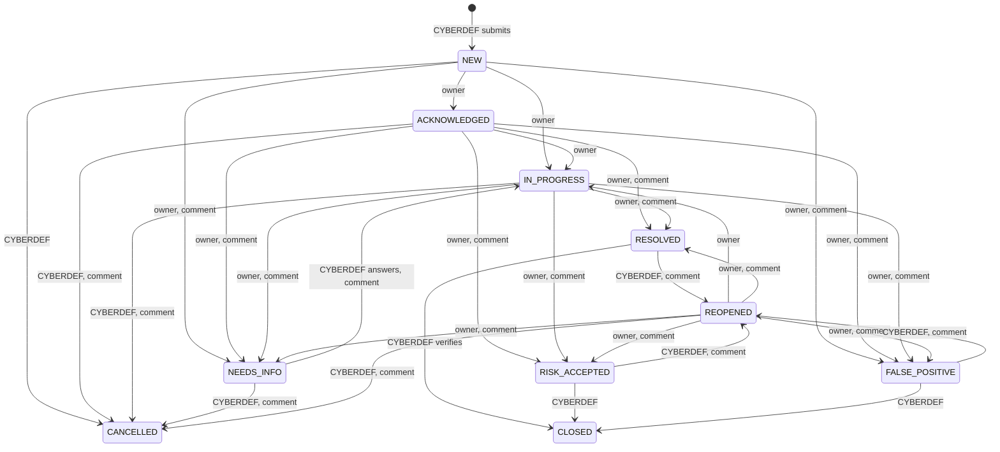

# CYBERDEF Account Tickets

The cyber-defence team (role `CYBERDEF`) reports vulnerability findings about **AWS
accounts** to SecMan through MCP. SecMan turns each finding into a ticket, mails the
people allocated to that account, and tracks the ticket through a server-enforced
workflow. Owners answer in the UI (Phase 2) or through MCP. Cyber Defence polls a
cursor feed for the answers.

Status: **Phase 1 (backend, REST, MCP) implemented.** The UI pages
(`/security-tickets`, `/cyberdef`), sample scripts and SLA reminders follow in Phases 2–3.
Mail already links to `/security-tickets/{id}`; that page arrives with Phase 2.

## Roles and access

| Action | CYBERDEF | ADMIN | SECCHAMPION | Account member | Others |
|---|---|---|---|---|---|
| Submit tickets | ✔ | ✔ | ✖ | ✖ | ✖ |
| Read **all** tickets | ✔ | ✔ | ✔ | ✖ | ✖ |
| Read tickets of own accounts | — | — | — | ✔ | ✖ |
| Owner transitions | only with account access | ✔ | ✔ | ✔ | ✖ |
| Defender transitions | ✔ | ✔ | ✖ | ✖ | ✖ |
| Comment (non-terminal tickets) | ✔ | ✔ | ✔ | ✔ | ✖ |
| Mail delivery status / resend | ✔ | ✔ | ✖ | ✖ | ✖ |

- `CYBERDEF` grants **no** asset, vulnerability or account visibility of its own. Its
  MCP role mapping is `TICKETS_SUBMIT` only.
- An *account member* is anyone with access to the ticket's AWS account under the same
  rule the asset inventory uses (`AssetFilterService.getAccessibleAwsAccountIds`):
  personal mapping, membership of an enabled workgroup with an AWS-account grant, or
  received AWS-account sharing. It is evaluated **live**, so revoking a grant removes
  access to the account's tickets at once.
- A ticket outside the caller's scope returns **404** (REST) or `NOT_FOUND` (MCP), never
  403. That way ids reveal nothing about other accounts.
- The two MCP status tools each act for one side only: `set_cyberdef_ticket_status` acts
  as defender, `update_my_security_ticket_status` as owner. A CYBERDEF user who is also
  an account member cannot resolve and then close their own ticket through one tool.

## Workflow



The table lives in `CyberdefTicketWorkflow` and nowhere else. Every response carries
`allowedTransitions` and `commentRequiredFor` for the **calling** user. Clients render
those values, and the server re-checks every move inside the write transaction.

Every status change takes `expectedVersion` (the `ticket.version` you last read). A
mismatch returns `VERSION_CONFLICT` and changes nothing, so two people cannot overwrite
each other. `CLOSED` and `CANCELLED` are terminal and accept no further comments.
Tickets are never deleted; `CANCELLED` is the end state for mistakes.

## Submitting

- **Idempotency**: `externalReference` (your own id, `[A-Za-z0-9._:/#-]{1,128}`) is
  unique per submitter. Resending it returns the existing ticket with outcome
  `DUPLICATE` and sends no second mail, so retries are always safe.
- **Batch**: `create_cyberdef_tickets` takes 1–100 items, commits each in its own
  transaction and returns `CREATED | DUPLICATE | REJECTED` per item. One bad item never
  fails the rest.
- **Unrouted accounts**: when nobody is allocated to the account, the item is rejected
  with `UNROUTABLE_ACCOUNT`. Send `allowUnrouted: true` to create it anyway, with zero
  recipients. Such a ticket is visible only to the global roles until someone is
  mapped to the account.
- **Due date**: defaults from the severity SLA (below). A submitted `dueAt` may shorten
  the SLA, never extend it. INFO has no SLA by default and accepts at most 365 days.
- **Limits**: title 200, description 20 000, recommended action 10 000, comment 4 000
  characters; 100 CVEs, 500 resources, 20 references per ticket; at most
  `max-tickets-per-hour` submissions per submitter. Unknown fields are rejected, so a
  typo cannot silently drop data.
- **References** must be absolute `https` URLs without credentials. They are displayed
  only; the backend never fetches them.

## Notifications

Recipients are resolved once, at creation, by `CyberdefRecipientResolver`:

1. Every personal mapping of the account, including future users who have no login
   yet. They receive the mail and see the ticket once their account exists.
2. Direct members of **enabled** workgroups that hold an AWS-account grant for it.

Addresses are lower-cased, validated and deduplicated, then capped at `max-recipients`.
A cap hit is logged. Received AWS-account sharing grants visibility but **no mail**.
The recipient list is an audit record and grants no access.

| Event | Who is mailed | Template |
|---|---|---|
| Ticket created | the recipients | `cyberdef-ticket-created` |
| CYBERDEF reopens, answers NEEDS_INFO, or cancels | the recipients | `cyberdef-ticket-update` |
| An owner changes the status | the submitter, only with `notify-submitter: true` | `cyberdef-ticket-update` |
| CLOSED | nobody | — |

Mail goes through an outbox (`cyberdef_ticket_notification`). Rows are written in the
same transaction as the change and sent afterwards on the IO pool, never inside a
transaction. Each row is claimed with one conditional `UPDATE`, so it is sent at most
once. Rows left `PENDING` by a crash are picked up by a job every 5 minutes. A transport
failure after the provider may have accepted the message is stored as `UNCERTAIN` and
never retried automatically. `FAILED` rows can be resent by CYBERDEF/ADMIN.

By default the mail carries only the ticket key, account, severity, title, due date and a
link. Description, comments and resources stay behind the login unless
`include-summary: true`.

## REST API (`/api/security-tickets`)

| Method & path | Roles | Purpose |
|---|---|---|
| `GET /` | authenticated, scoped | Paged list. Query: `status`, `severity` (repeat or comma list), `accountId`, `createdByMe`, `overdue`, `updatedSince` (ISO-8601), `q` (title or exact key), `page`, `size` (≤ 200), `sort` (`updatedAt`/`createdAt`/`dueAt`), `direction` |
| `GET /summary` | authenticated, scoped | `total`, `open`, `overdue`, `needsAction`, `byStatus` |
| `GET /{id}` | scoped | Detail with resources, CVEs, events, `allowedTransitions` |
| `POST /{id}/transitions` | scoped + workflow | `{toStatus, comment, expectedVersion}` |
| `POST /{id}/comments` | scoped | `{comment}` |
| `POST /` | ADMIN, CYBERDEF | Submit one ticket (body as the MCP create tool). 201 created, 200 duplicate |
| `GET /{id}/notifications` | ADMIN, CYBERDEF | Mail delivery per recipient |
| `POST /{id}/notifications/resend` | ADMIN, CYBERDEF | Retry `FAILED` rows |

Errors are `{"error": CODE, "message": text}`: 400 `VALIDATION_ERROR` / `COMMENT_REQUIRED`,
403 `FORBIDDEN`, 404 `NOT_FOUND`, 409 `VERSION_CONFLICT` / `INVALID_TRANSITION`,
422 `UNROUTABLE_ACCOUNT`, 429 `RATE_LIMITED`.

## MCP tools

All tools require User Delegation (`X-MCP-User-Email`). The submit tools additionally
require a delegated user holding `CYBERDEF` or `ADMIN`; an admin API key alone is not
enough.

| Tool | Permission | Side |
|---|---|---|
| `create_cyberdef_ticket` | `TICKETS_SUBMIT` | defender |
| `create_cyberdef_tickets` | `TICKETS_SUBMIT` | defender |
| `list_cyberdef_tickets` | `TICKETS_SUBMIT` | defender |
| `get_cyberdef_ticket` (by `id`, `ticketKey` or your `externalReference`) | `TICKETS_SUBMIT` | defender |
| `get_cyberdef_ticket_updates` | `TICKETS_SUBMIT` | defender |
| `set_cyberdef_ticket_status` | `TICKETS_SUBMIT` | defender |
| `add_cyberdef_ticket_comment` | `TICKETS_SUBMIT` or `TICKETS_RESPOND` | either |
| `list_my_security_tickets` | `TICKETS_RESPOND` | owner |
| `get_my_security_ticket` | `TICKETS_RESPOND` | owner |
| `update_my_security_ticket_status` | `TICKETS_RESPOND` | owner |

`TICKETS_RESPOND` is part of every delegated user's effective permissions, the same way
as `PERSONAL_INVENTORY_READ`, because the tools scope everything to the caller's
accounts. The API key still caps it: a key without the permission cannot use the tools.

Error codes are a stable contract: `VALIDATION_ERROR`, `COMMENT_REQUIRED`,
`INVALID_TRANSITION`, `FORBIDDEN`, `NOT_FOUND`, `VERSION_CONFLICT`,
`UNROUTABLE_ACCOUNT`, `RATE_LIMITED`, `DELEGATION_REQUIRED`, `INTERNAL_ERROR`.

### Example: submit

```json
{
  "name": "create_cyberdef_ticket",
  "arguments": {
    "externalReference": "SOC-2026-4711",
    "awsAccountId": "123456789012",
    "title": "Publicly exposed RDS snapshot",
    "severity": "HIGH",
    "description": "Snapshot `db-prod-2026-11-20` is shared with `all`.",
    "recommendedAction": "Remove the public restore permission and rotate the DB credentials.",
    "resources": [{"type": "RDS_SNAPSHOT", "identifier": "arn:aws:rds:eu-central-1:123456789012:snapshot:db-prod-2026-11-20", "region": "eu-central-1"}],
    "references": ["https://docs.aws.amazon.com/AmazonRDS/latest/UserGuide/USER_ShareSnapshot.html"],
    "sourceSystem": "guardduty"
  }
}
```

Returns `{"index":0,"outcome":"CREATED","ticketId":42,"ticketKey":"CD-2026-000042","status":"NEW","recipientCount":3}`.

### Handling answers: the update feed

`get_cyberdef_ticket_updates {sinceEventId, limit}` returns every event after the cursor,
oldest first: creations, status changes and comments, each with `ticketId`, `ticketKey`,
`actorKind`, `fromStatus`, `toStatus` and `comment`. It also returns `nextCursor` and
`hasMore`. Store `nextCursor` durably and pass it back next time. Each event is then seen
exactly once.

Events younger than five seconds are held back. Ids are allocated at insert but become
visible at commit, so this settle window keeps a poller from skipping an event whose
lower id was still uncommitted.

A typical loop:

1. Read the feed. For each `STATUS_CHANGED` to `NEEDS_INFO`, answer with
   `set_cyberdef_ticket_status {toStatus: IN_PROGRESS, comment}`.
2. For `RESOLVED` / `RISK_ACCEPTED` / `FALSE_POSITIVE`, verify, then `CLOSED`, or
   `REOPENED` with a comment.
3. Pass `expectedVersion` from `get_cyberdef_ticket`. Reload and retry on
   `VERSION_CONFLICT`.

## Configuration (`secman.cyberdef.*`)

| Key | Env | Default | Meaning |
|---|---|---|---|
| `sla.critical-days` … `sla.info-days` | `CYBERDEF_SLA_*_DAYS` | 2 / 7 / 30 / 90 / 0 | Default due window; 0 = none |
| `mail.include-summary` | `CYBERDEF_MAIL_INCLUDE_SUMMARY` | `false` | Put description/comment into mail |
| `mail.notify-submitter` | `CYBERDEF_MAIL_NOTIFY_SUBMITTER` | `false` | Mail the submitter on owner changes |
| `max-recipients` | `CYBERDEF_MAX_RECIPIENTS` | 50 | Recipient cap per ticket |
| `max-tickets-per-hour` | `CYBERDEF_MAX_TICKETS_PER_HOUR` | 600 | Submissions per submitter per hour |

The mail link uses `app.frontend.base-url`.

## Data model

Migration `V310__cyberdef_tickets.sql`: `cyberdef_ticket` (with `@Version`),
`cyberdef_ticket_resource`, `cyberdef_ticket_event` (append-only; id = cursor),
`cyberdef_ticket_recipient` (audit) and `cyberdef_ticket_notification` (outbox). Users
are referenced by id plus a username snapshot without a foreign key, so the
inactive-user cleanup can delete accounts without losing ticket history.

## Security notes

- A01: every read and write resolves through `CyberdefTicketAccess`. List queries take
  the account set computed in Kotlin as a bound parameter. The workflow is re-checked
  inside the write transaction.
- A03/A09: free text keeps newlines and tabs but loses other control characters;
  single-line fields lose newlines too. HTML mail escapes every value, and submitter
  text is substituted last, so a `{placeholder}` inside a title stays literal. Audit log
  lines carry actor, target and outcome, never comment bodies.
- A04: every field, list, page and batch is bounded, and submissions are rate-limited
  per submitter.
- A10: reference URLs are display-only and never fetched.

## Code map

`domain/CyberdefTicket*.kt` · `repository/CyberdefTicket*Repository.kt` ·
`service/cyberdef/` (`CyberdefTicketWorkflow`, `CyberdefTicketInput`,
`CyberdefRecipientResolver`, `CyberdefTicketAccess`, `CyberdefTicketWriter`,
`CyberdefTicketMailer`, `CyberdefTicketService`, `CyberdefTicketQueryService`) ·
`controller/CyberdefTicketController.kt` · `mcp/tools/*Cyberdef*Tool.kt`,
`*SecurityTicket*Tool.kt` · `email-templates/cyberdef-ticket-*.{html,txt}`.
